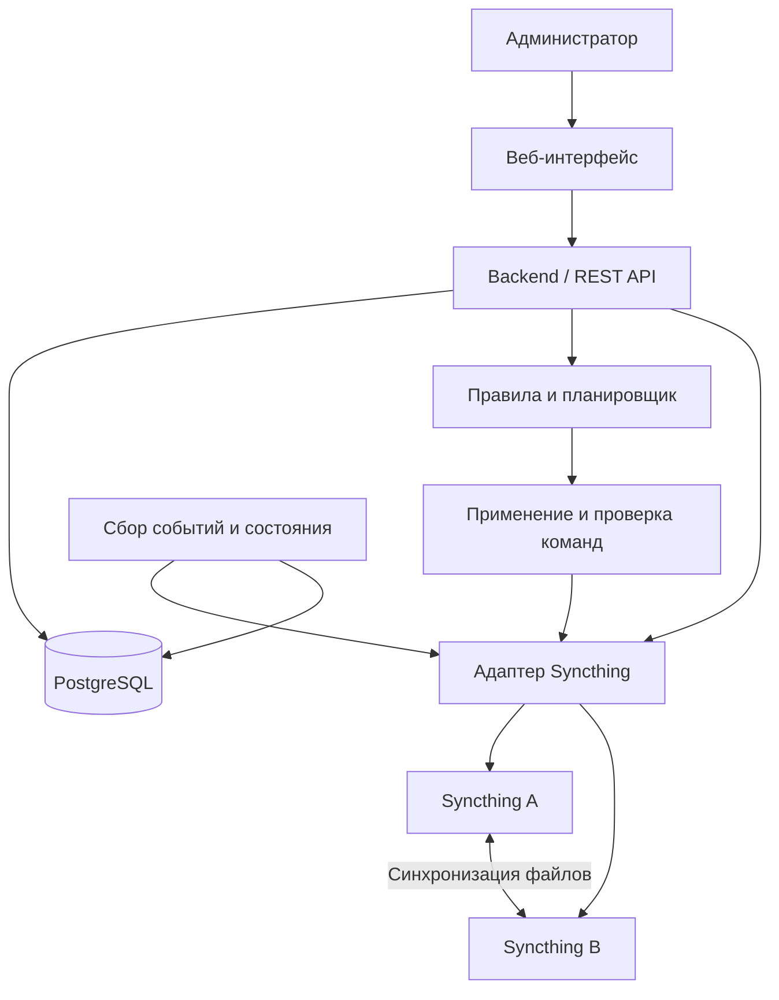

# Syncthing Control Center

Курсовой проект «Централизованное управление и контроль синхронизации файлов на базе Syncthing».

Планируется разработать клиент-серверную систему с единой веб-панелью для наблюдения за несколькими экземплярами Syncthing, управления синхронизацией по расписанию и просмотра истории её работы. Проект выполняется командой из двух студентов направления «Прикладная информатика».

**Текущий статус:** реализация A0.1–A0.4 подготовлена к review danilsdk. Есть контракт, каркас FastAPI, семь моделей и миграция PostgreSQL, все 30 публичных типов, протоколы адаптера/Clock, общие блокировки и точка подключения worker. Контракт остаётся draft до согласования. Предметные маршруты, полноценный вход, рабочий цикл исполнителя и развёртывание относятся к следующим задачам.

**Harness H0 принят 28.10.2026:** [PR #1](https://github.com/danilsdk/syncthing-control-center/pull/1).
Участники: A / playerboom — интеграция и данные; B / danilsdk — автоматизация,
интерфейс и harness. Порядок работы — [docs/harness.md](docs/harness.md).
Подготовка A9 и обновление цепочки A0–A4 явно поручены пользователем;
[оформление согласованных границ](docs/design/a/a9-scope-authorization.md)
проходит отдельный review принятой политики, результат A9 сохраняется.

## Запуск каркаса A0.2

Из корня проекта под Python 3.12, Windows PowerShell:

```powershell
py -3.12 -m venv .venv
.\.venv\Scripts\python.exe -m pip install -r backend/requirements-dev.txt -e "./backend[dev]"
.\.venv\Scripts\python.exe -m uvicorn app.main:create_app --factory --host 127.0.0.1 --port 8000
```

`/health/live` возвращает 200. `/health/ready` возвращает 503, пока БД и миграция
не готовы; автоматического создания таблиц нет. Подробности для Windows/Linux,
настройки и проверки — в [инструкции A0.2](docs/design/a/a02-runbook.md).
Применение миграции к отдельной базе разработки и проверка на собственном
временном PostgreSQL — в [инструкции A0.3](docs/design/a/a03-runbook.md).
Общие импорты, подключение роутеров, работа с блокировкой и worker —
в [инструкции передачи A0.4](docs/design/a/a04-handoff.md).

## Задача проекта

Администратор должен видеть состояние устройств и папок в одном интерфейсе, задавать временные окна синхронизации и отслеживать выполнение правил. Например, для общей папки рабочего компьютера и сервера можно разрешить синхронизацию только в выбранные дни и часы.

Собственная часть проекта — модель управляемых узлов и папок, правила автоматизации, проверка результатов команд, обработка недоступности узлов, накопление истории и аналитика.

Центральный сервер будет хранить служебные данные и передавать команды через REST API Syncthing. Содержимое файлов остаётся на устройствах и синхронизируется средствами Syncthing; центральный сервер не используется как файловое хранилище.

## Планируемые возможности MVP

- Подключение двух тестовых экземпляров Syncthing и просмотр их папок.
- Отображение доступности узлов, приостановки папок и обнаруженных ошибок.
- Настройка одного активного расписания для каждой пары «экземпляр — папка» с учётом часового пояса.
- Приостановка и возобновление папки по расписанию с проверкой фактического результата команды.
- Повторный расчёт актуального состояния после восстановления связи или перезапуска сервера.
- Журнал событий и попыток применения правил, периодические снимки состояния.
- Базовая аналитика: доля подтверждённых команд, число ошибок и наблюдаемая доступность.
- Веб-интерфейс с авторизацией администратора.
- Воспроизводимый тестовый стенд и демонстрационное развёртывание.

Границы MVP: два экземпляра Syncthing, одна–две тестовые папки и один администратор. Разработка собственного протокола передачи файлов, автоматическое разрешение файловых конфликтов, резервное копирование и полноценное управление всеми настройками Syncthing не входят в объём проекта.

## Предлагаемая архитектура



Для первого стенда предполагаются два экземпляра Syncthing в изолированной Docker-сети. Сервер обращается к их API по внутренней сети. Результат управления подтверждается повторным чтением состояния; успешный HTTP-ответ сам по себе не считается подтверждением выполнения правила.

## Предварительный стек

| Компонент | Планируемые технологии |
|---|---|
| Серверная часть | Python, FastAPI |
| База данных и миграции | PostgreSQL, SQLAlchemy, Alembic |
| Веб-интерфейс | HTML, CSS, JavaScript; выбор фреймворка открыт |
| Автоматизация | Планировщик и исполнитель команд; конкретный инструмент будет выбран позже |
| Синхронизация файлов | Syncthing и его REST API |
| Тестовое окружение | Docker Compose, два экземпляра Syncthing |
| Проверки | pytest, Ruff; типизация и E2E-проверки по мере реализации |
| Развёртывание | VPS, HTTPS |

Версии backend и инструментов проверки закреплены в `backend/pyproject.toml`
и `backend/requirements*.txt`. Остальные компоненты таблицы остаются планом.

## Структура репозитория

```text
.
├── README.md
├── .gitignore
├── syncthing_coursework_mvp_plan.md  # исходный рабочий план проекта
├── backend/
│   ├── app/
│   │   ├── api/                    # собственный REST API
│   │   ├── registry/               # учёт управляемых узлов и папок
│   │   ├── syncthing_adapter/      # интеграция с API Syncthing
│   │   ├── scheduling/            # расписания и желаемое состояние
│   │   ├── reconciliation/        # применение и проверка команд
│   │   ├── collection/            # события и снимки состояния
│   │   ├── analytics/             # показатели по сохранённой истории
│   │   └── models/                # модели данных
│   └── migrations/                # Alembic и начальная схема семи таблиц
├── frontend/
│   └── src/                       # будущий веб-интерфейс
├── tests/
│   ├── unit/
│   ├── contract/
│   ├── integration/
│   └── e2e/
├── docs/
│   ├── requirements.md            # рабочие требования MVP
│   └── architecture.md            # компоненты и принципы взаимодействия
├── deploy/                        # будущая конфигурация стенда и VPS
└── scripts/                       # будущие команды разработки и проверок
```

Пустые каталоги содержат `.gitkeep`, чтобы структура сохранялась в Git. Эти файлы не реализуют поведение приложения.

## Документация

- [Каркас A0.2: установка и запуск](docs/design/a/a02-runbook.md) — health, настройки, ограничения текущего этапа и проверки.
- [Общий контракт A0.1](docs/contracts.md) — версия 0.1.0-draft: схема, API, DTO и интерфейс адаптера; review запланирован после завершения всего A0.
- [Передача A0.1 и подэтапы A0](docs/design/a/a01-review.md) — проверки спецификации и порядок продолжения.
- [Решения MVP от 24.10.2026](docs/design/a/mvp-decisions.md) — выбранное поведение событий, отключения правил, расписаний, подтверждения и аналитики; уточняет исходный план.
- [Подготовка A0 и задачи двух разработчиков](docs/design/a/a0-readiness.md) — роли, последовательность, зависимости и критерии начала работы.
- [Исходный рабочий план курсового проекта](syncthing_coursework_mvp_plan.md) — подробное описание, сценарии, этапы, тестовый план и распределение работы.
- [Требования MVP](docs/requirements.md) — краткий перечень планируемых сценариев и условий готовности.
- [Архитектура](docs/architecture.md) — ответственность компонентов и основные проектные ограничения.

Документация основана на рабочем плане проекта. Она не является утверждённым преподавателем техническим заданием.

## Дальнейшие этапы

1. Проверить возможности REST API на выбранной версии Syncthing в изолированном стенде.
2. Подготовить backend, модели БД, миграции и окружение Docker Compose.
3. Реализовать адаптер, реестр узлов и сбор событий.
4. Добавить расписания, применение команд и проверку результата.
5. Реализовать веб-интерфейс, историю и базовую аналитику.
6. Добавить автоматические проверки, демонстрацию на VPS и материалы отчёта.

## Правила работы с репозиторием

- Изменения вести в отдельных ветках и согласовывать через pull request.
- Интеграцию с Syncthing выполнять через выделенный адаптер.
- При реализации бизнес-логики добавлять соответствующие проверки.
- Пароли, API-ключи, реальные `.env`, локальные базы данных и содержимое синхронизируемых папок хранить вне Git. Образцы конфигурации добавлять без действующих секретов.
- Для интеграционных проверок использовать отдельные демонстрационные папки и закрытый доступ к API Syncthing.
