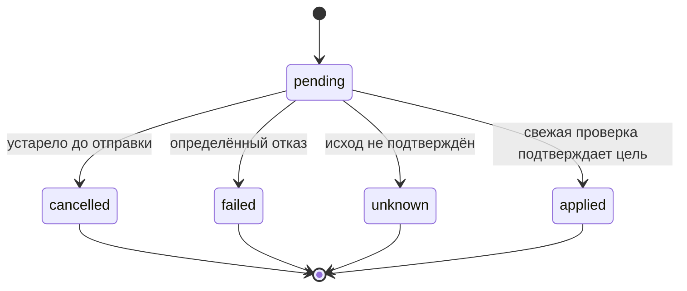

# Общий контракт модулей — 0.1.0-draft

Статус: **A0.1 подготовлен; A0 в работе**. По решению пользователя формальный
review выполняется после завершения A0.1–A0.4; до этого PR №2 остаётся Draft.
Владелец — A / playerboom, проверяющий потребитель — B / danilsdk.
В A0.2 добавлен системный каркас с health, настройками, подключением БД,
едиными ошибками и закрытой зависимостью доступа. В A0.3 реализованы модели
семи таблиц и миграция с проверками на PostgreSQL. Предметные маршруты,
полные Python DTO и протоколы ещё предстоят.
Контракт становится принятым после фактического review B, а не после отметки автора.

Основные материалы:

- [Решения D-01–D-05](design/a/mvp-decisions.md) — семантика продукта.
- [Модель семи таблиц и ограничения](design/a/data-model.md) — основа A0.3.
- [OpenAPI 3.1](design/a/openapi.json) — точные поля запросов/ответов и маршруты.
- [JSON-примеры и граничные случаи](design/a/contract-examples.json).
- [Проверка и вопросы для B0](design/a/a01-review.md).

При изменении полей сначала обновляются контракт, OpenAPI и примеры одним PR A.
Изменения формул и сценариев проходят review B. В A0.4 появятся общие Python
типы; до этого B использует JSON-примеры как явно обозначенные тестовые данные.

## 1. Общие соглашения

- Корень предметного API — `/api`. Все операции, кроме входа и `/health/*`,
  требуют авторизованного активного администратора. Регистрации пользователей нет.
- Внутренние `id`, `node_id`, `folder_id`, `rule_id` — UUID приложения.
  Syncthing Device ID и локальный `syncthing_folder_id` — отдельные строки.
  Собственный API принимает UUID записи папки; адаптер получает внешний Folder ID.
- Имена JSON-полей — `snake_case`. Неизвестные поля запросов отвергаются.
  Пароли, API-ключи, физические пути и сырые тела ответов Syncthing не возвращаются.
- Ответы времени — RFC 3339 в UTC с `Z`; точность до микросекунд.
  Исходный `startTime` источника хранится отдельно точной строкой с его долями секунды.
  Время окна — строго `HH:MM`; дни ISO 1–7, IANA timezone.
- Неизвестное значение — `null`. Оно не заменяется `false`, `0` или статусом успеха.
- Списки: `{items, total, limit, offset}`; `limit=50`, диапазон 1–100,
  `offset>=0`. `total` считается после фильтров. Объём ограничивается на сервере.
- Узлы сортируются по `display_name,id`, остальные списки по времени создания
  и `id` по убыванию. Для событий используется `received_at`, снимков — `observed_at`.
  Offset-пагинация не обещает неизменность списка при новых записях.
- Период `[from,to)` — начало включено, конец исключён. Для истории фильтр
  применяется к `created_at` команд, `received_at` событий и `observed_at` снимков.
  Без границ история не ограничивается по времени, но всегда имеет пагинацию.
- Для аналитики обе границы обязательны, `from<to`, максимум 31 сутки.
  Соотношения возвращаются числами 0–1; формат процентов задаёт UI.
- Все ошибки имеют единый `Error`, включая ошибки валидации FastAPI.
  Сервер создаёт UUID `request_id`; он также возвращается заголовком `X-Request-ID`.
  В `details` допускаются только имя поля и безопасное объяснение, без значения ввода.

```json
{"error":{"code":"version_conflict","message":"Правило уже изменено","details":[],"request_id":"44444444-4444-4444-8444-444444444444"}}
```

## 2. Доступ и регистрация экземпляров

Выбран один администратор и подписанная cookie-сессия `scc_session`.
Cookie: `HttpOnly`, `SameSite=Lax`, `Secure` в HTTPS-окружении; абсолютный срок
8 часов. В cookie только ID пользователя, срок и CSRF-значение, без пароля/ключей.
Каждый защищённый запрос проверяет подпись, срок и `app_users.is_active`.
Секрет подписи задаётся серверной конфигурацией вне Git. В A0.2/A0.4 до реализации
A2 общая зависимость авторизации закрывает управление с `503 auth_not_configured`.

Каждое изменение, включая вход, требует `Origin` из серверного allowlist;
отсутствующий/чужой Origin даёт 403. Все изменения после входа требуют
`X-CSRF-Token`, совпадающий с токеном текущей сессии. Токен возвращается входом
и `/api/auth/me`; UI хранит его в памяти. Выход удаляет cookie. Проверка пароля,
его хеширование и защита от частых попыток входа относятся к A2.
Для dev допускается явная настройка HTTP на localhost; она не является production-default.

Адреса Syncthing и ссылки на API-ключи задаются серверным allowlist.
`connection_ref` — псевдоним настройки, например `node-a`, не URL/секрет.
API не принимает произвольные адреса и не следует перенаправлениям источника.
Один псевдоним регистрируется один раз; смена реального Device ID после регистрации
даёт `identity_mismatch`, прекращает команды и требует вмешательства администратора.
`POST /api/nodes` создаёт запись после проверки статуса и чтения конфигурации папок;
при ошибке источника частично зарегистрированного узла нет.

## 3. Маршруты и ответственность

Точные запросы, коды и ответы определены [OpenAPI](design/a/openapi.json).

| Метод и маршрут | Результат | Владелец реализации |
|---|---|---|
| GET `/health/live`, `/health/ready` | Живой процесс / доступная БД и завершённые миграции | A0.2/A0.3 |
| POST `/api/auth/login` | Session, cookie; неверный вход — 401 | A2 |
| GET `/api/auth/me`, POST `/api/auth/logout` | Текущая сессия / 204 | A2 |
| GET `/api/connections` | Только псевдонимы и подписи разрешённых подключений | A2 |
| GET, POST `/api/nodes` | Список / Node, 201 после проверки подключения | A2 |
| GET, PATCH `/api/nodes/{node_id}` | Чтение / изменение имени и enabled | A2 |
| GET `/api/nodes/{node_id}/folders` | Папки данного экземпляра | A2 |
| GET, POST `/api/rules` | Список / Rule, 201 | B1 |
| GET, PATCH, DELETE `/api/rules/{rule_id}` | Чтение / Rule / 204 | B1 |
| GET `/api/executions`, GET `/api/executions/{execution_id}` | История / Execution | B2 |
| POST `/api/executions/resume` | Execution, 202; повтор принятого запроса — 200 | B2 |
| GET `/api/events`, `/api/snapshots` | События / наблюдения | A3 |
| GET `/api/analytics/summary` | Две метрики и дневные точки UTC | B4 |

Объединение роутеров в приложении ведёт A. B экспортирует `router` из
`rules.py`, `executions.py`, `analytics.py`; бизнес-логика остаётся в пакетах B.
Зависимости текущего администратора, сессии БД и адаптера ведёт A.
Предметные DELETE узлов/папок и изменение файлов в MVP отсутствуют.

## 4. DTO и актуальность состояния

| DTO | Основная семантика |
|---|---|
| Node | `api_status`, `last_checked_at` любой проверки, `last_seen_at` успешной, `is_stale` |
| Folder | `actual_paused` и `config_observed_at` отдельно от `runtime_state` и `runtime_observed_at`; `desired_paused` от активного правила |
| Rule | Неизменяемый `folder_id`, параметры времени, `enabled`, целая `version>=1` |
| Execution | Источник, UUID папки, снимок правила, цель, результат, отметки времени и безопасный код причины |
| Event | ID приложения, сессия и ID источника либо локальный маркер разрыва/перезапуска |
| Snapshot | Одно наблюдение `scope=node` либо `scope=folder`, включая неуспешное |
| Analytics | Числители/знаменатели, отношения либо null, отдельные unknown/cancelled/pending |

`api_status`: `unknown`, `ok`, `unreachable`, `auth_error`, `invalid_response`,
`identity_mismatch`. Это состояние последней проверки API, не общее здоровье папки.
Отдельный статус `paused` в этот enum не входит.

Стартовые интервалы: сверка правил — 15 секунд, наблюдения — 30 секунд,
порог устаревания — 60 секунд; все настраиваются. Наблюдение устарело при
отсутствии данных, превышении порога, выключенном узле или ошибке последней проверки.
Ошибка узла не стирает последнее известное значение папки: UI использует его
только вместе со временем и признаком устаревания. Для Folder `is_stale` относится
к конфигурации `actual_paused`; runtime имеет собственное время и проверяется отдельно.
Узел может быть доступен при paused/error папке. `runtime_state` сохраняет строку
Syncthing; неизвестный новый state не превращается в `idle`.

## 5. Правила и конкурентные изменения

POST Rule получает `folder_id`, дни и границы; defaults — Moscow и enabled=true.
Новая версия — 1. Папка должна присутствовать; активное правило нельзя включить
для выключенного узла. Остальные условия времени заданы D-03.
Дни в ответах отсортированы; дубликаты во входе отвергаются.

PATCH требует `expected_version` и минимум одно изменяемое поле. Менять UUID папки
через PATCH нельзя. Проверяется весь результат частичного изменения. При реальном
изменении версия увеличивается; повтор с теми же значениями возвращает ту же версию.
DELETE требует query `expected_version`. Несовпадение версии — 409 `version_conflict`.
Конкурентное включение второго правила — 409 `active_rule_conflict`, в том числе
при срабатывании уникального индекса БД. История при удалении сохраняется.

Все изменения правил и начало команды используют одну сеансовую advisory-блокировку
по UUID папки в PostgreSQL. Исполнитель делает предварительное чтение через адаптер,
затем под блокировкой повторно проверяет существование/версию правила и фиксирует
sent_at отдельным commit **до HTTP-вызова**. sent_at означает начало попытки,
а не доказательство, что запрос дошёл. PATCH выполняется с ограниченным таймаутом;
дальнейшая проверка результата идёт вне неё. Поэтому подтверждённое отключение
не оставляет возможность начать отправку по прежней версии. После отправки
изменение всё ещё возможно и обрабатывается как D-04.

Advisory-блокировка удерживается выделенным соединением через commit; row lock,
снятый commit, её не заменяет. Все участники используют общий helper A0.4 с
одинаковым стабильным ключом из UUID. finally снимает блокировку, потеря соединения
тоже её освобождает. Соединение с удерживаемой блокировкой не возвращается в pool.
Это сохраняет и сериализацию отключения, и запись начала отправки при падении worker.

Ручное возобновление имеет `folder_id` и UUID `idempotency_key`. Ключ уникален
для администратора: тот же ключ/папка возвращает прежнюю Execution без отправки
второй команды, тот же ключ/другая папка даёт 409 `idempotency_conflict`.
Проверка повторного ключа предшествует проверке текущего правила.
Новая ручная команда требует отсутствия активного правила и другой pending-команды
папки. Пока ручная команда pending, включение правила отвергается с
409 `operation_in_progress`. Новая команда — 202, её результат читается GET.
Недоступность узла в момент исполнения фиксируется в Execution, а не ложным 200.

## 6. Переходы команд



| Статус | sent_at | verified_at | completed_at | error_code |
|---|---|---|---|---|
| pending | null или время отправки | null | null | null |
| cancelled | null | null | обязательно | обязательно |
| failed | null или время отправки | время определённого неприменения либо null | обязательно | обязательно |
| unknown | null или время отправки | время полученного, но недостаточного наблюдения либо null | обязательно | обязательно |
| applied | обязательно | обязательно | обязательно | null |

Причины отмены до отправки: `rule_disabled`, `rule_deleted`,
`rule_changed_before_send`, `node_disabled`, `folder_missing`,
`authorization_revoked`, `already_satisfied`. Неопределённые исходы после отправки:
`write_outcome_unknown`, `verification_timeout`, `verification_unavailable`,
`restart_required`, `source_session_changed`, `rule_changed_after_send`,
`worker_interrupted`. Определённый отказ — `command_rejected`, подтверждённое
несовпадение после ограниченного ожидания — `verification_mismatch`.
Подтверждение ограничено 10 секундами; если стабильное несовпадение не установлено,
недостаточные наблюдения дают unknown, а не предполагаемый failed.

Терминальная попытка неизменяема; повтор — новая попытка после расчёта текущего
правила. Если перед отправкой цель уже достигнута, создаётся только наблюдение.
Для ручного намерения, уже принятого в очередь, такой исход — `cancelled` с
`already_satisfied`; это не подтверждённая отправка и не входит в success ratio.

`applied` требует совпадения `observed_paused`, `restart_required=false`, той же
сессии источника и актуальной версии правила. Для manual повторно проверяется
отсутствие активного правила. Это подтверждает конфигурацию, а не доставку файла.

После перезапуска worker незавершённая отправленная попытка становится `unknown`
с `worker_interrupted`; автоматическое намерение без отправки отменяется и
пересчитывается. Ручное намерение без отправки можно обработать после повторной
проверки условий и активности администратора. Старое sent-намерение не проигрывается.

## 7. Адаптер и запуск исполнителя

Предлагаемые общие типы разместить в `backend/app/contracts/` в A0.4.
Интерфейс синхронный; DB и HTTP клиент синхронные. Worker — отдельный процесс,
API использует обычные `def` обработчики для блокирующей логики.
Фабрика адаптера получает серверный `NodeConnection`, а не параметры из браузера.

```text
AdapterFactory.for_node(node_id: UUID) -> SyncthingAdapter
SyncthingAdapter.read_system() -> SystemObservation
SyncthingAdapter.list_folders() -> list[FolderConfig]
SyncthingAdapter.read_folder(folder_id: str) -> FolderConfig
SyncthingAdapter.read_runtime(folder_id: str) -> FolderRuntime
SyncthingAdapter.set_paused(folder_id: str, paused: bool) -> None
SyncthingAdapter.restart_required() -> bool
SyncthingAdapter.read_events(since: int, timeout_seconds: int = 15) -> EventBatch
```

| Тип | Поля |
|---|---|
| NodeConnection | node_id, base_url и API-ключ, полученный серверным resolver; секреты исключены из repr/log |
| SystemObservation | device_id, start_time_raw, source_session_id, observed_at |
| FolderConfig | syncthing_folder_id, label, paused, observed_at |
| FolderRuntime | state, need_bytes, pull_errors, observed_at |
| SourceEvent | id, global_id для диагностики, type, time_raw, безопасные выбранные данные |
| EventBatch | source_session_id, events, observed_at; сессия проверена до и после чтения |
| AdapterError | code, retryable, write_outcome; безопасное фиксированное сообщение, без URL/ключа/сырого ответа |

AdapterError.code: `timeout`, `unreachable`, `auth_error`, `not_found`,
`invalid_response`, `identity_mismatch`, `session_changed`. Повтор допустим для
timeout/unreachable/session_changed после сверки; неверный ключ и неожиданный
формат требуют исправления, бесконечные быстрые повторы не выполняются.

Для ошибки записи write_outcome — `not_applied` только при определённом отказе
(например, 401/403/404); по умолчанию `unknown`, включая timeout/потерю связи/5xx.
Для ошибок чтения это поле null. B2 не выводит исход записи только из имени
ошибки сети. Адаптер не делает скрытые повторы PATCH.

Обычный HTTP timeout — 5 секунд. Для long polling timeout Syncthing — 15 секунд,
HTTP read timeout — 20 секунд. Нормальный пустой EventBatch не является ошибкой.
Внешний Folder ID кодируется как один сегмент URL, другие поля передаются параметрами.
Адаптер меняет только `paused`. `set_paused()` не проверяет итог и не означает успех:
последующие чтения и запись результата выполняет B2.
EventBatch с изменившейся сессией отклоняется, курсор не продвигается.
Точные особенности выбранного релиза и обезличенные ответы проверяются в A1.

Точка запуска worker: `python -m app.main worker` из backend-окружения, создаётся в A0.4.
В A0.4 это точка подключения, не реализованный scheduler B. Рабочий цикл B2
экспортируется из `app.reconciliation`; A4 подключает его к запуску. В lifespan
FastAPI worker не создаётся. На всё время работы отдельный процесс удерживает
PostgreSQL advisory lock; второй процесс завершается, не отправляя команды.
Время расчёта передаётся явно через Clock.now_utc(), в тестах — fake Clock.

## 8. Коллектор, наблюдения и аналитика

D-01 определяет атомарную запись source-событий и курсора. Локальные маркеры
`HistoryGap`/`SourceRestarted` имеют `kind=gap/restart`, пустой `source_event_id`,
UUID приложения и сессию. Они не сдвигают source-курсор сами по себе.
`payload_summary` ограничен from_id/to_id, state, previous_session_id;
имена файлов, физические пути и произвольный payload отбрасываются.
Потерянные ID фиксируются включительным диапазоном `[from_id,to_id]`.

Node-проверка — успешное аутентифицированное и корректно разобранное чтение
system/status с ожидаемым Device ID. Она записывается один раз независимо от
числа папок и результатов чтения runtime. Folder-проверки записываются отдельно.
Пропуск запуска collector не создаёт выдуманную неуспешную проверку.

Метрика команд отбирает терминальные попытки по `completed_at` внутри периода;
pending_created считает ещё pending по `created_at`. История команд использует
created_at, поэтому её список за тот же период может отличаться от знаменателя метрики.
`success_ratio=applied/(applied+failed)`; остальные статусы отдельно.
Метрика API использует только node-наблюдения по `observed_at` и success.
Нулевой знаменатель даёт null. При фильтре source он действует только на команды.
Фильтр node_id действует на обе метрики. Показатели считаются одним согласованным
снимком БД, daily использует те же фильтры и UTC-даты; крайние даты обрезаны периодом.
Для каждого затронутого дня есть точка, в том числе с null при отсутствии проверок.
Период длиной 31 сутки со смещением может затронуть 32 даты UTC.

## 9. Коды ошибок

| HTTP | code | Условие |
|---|---|---|
| 401 | authentication_required / invalid_credentials | Нет подходящей сессии / неверный вход |
| 403 | csrf_invalid / origin_forbidden | Нет подходящего CSRF или Origin |
| 404 | node_not_found / folder_not_found / rule_not_found / execution_not_found | Нет записи приложения |
| 409 | active_rule_conflict / version_conflict | Второе правило / устаревшая версия |
| 409 | operation_in_progress / idempotency_conflict / node_disabled | Конфликт команды / ключа / выключенный узел |
| 409 | connection_already_registered | Повтор псевдонима подключения |
| 422 | validation_error / invalid_window / invalid_timezone / invalid_period / connection_not_allowed | Формат или бизнес-валидация |
| 429 | login_rate_limited | Ограничение попыток входа |
| 502 | upstream_unreachable / upstream_auth_error / upstream_invalid_response | Регистрация не может проверить источник |
| 504 | upstream_timeout | Таймаут проверки при регистрации |
| 503 | auth_not_configured / service_unavailable | Защита/БД ещё не готовы |

`retryable` не является основанием повторять старое правило. Ошибки фоновых
команд сохраняются в Execution и читаются через успешный GET, а не через HTTP
ошибку запроса истории. Для неизвестных UUID-фильтров коллекций возвращается
пустой результат; одиночные ресурсы и создание зависимого объекта дают 404.

## 10. Основания и границы проверки

- [Конфигурация Syncthing](https://docs.syncthing.net/rest/config.html).
- [Events и long polling](https://docs.syncthing.net/rest/events-get.html).
- [System status и startTime](https://docs.syncthing.net/rest/system-status-get.html).
- [Runtime папки; стоимость опроса](https://docs.syncthing.net/rest/db-status-get.html).
- [OpenAPI 3.1.0](https://spec.openapis.org/oas/v3.1.0.html).

Проверка спецификации и JSON-примеров не заменяет реальные ответы A1, применение
миграции A0.3, общие Python типы A0.4 и согласование B0.
