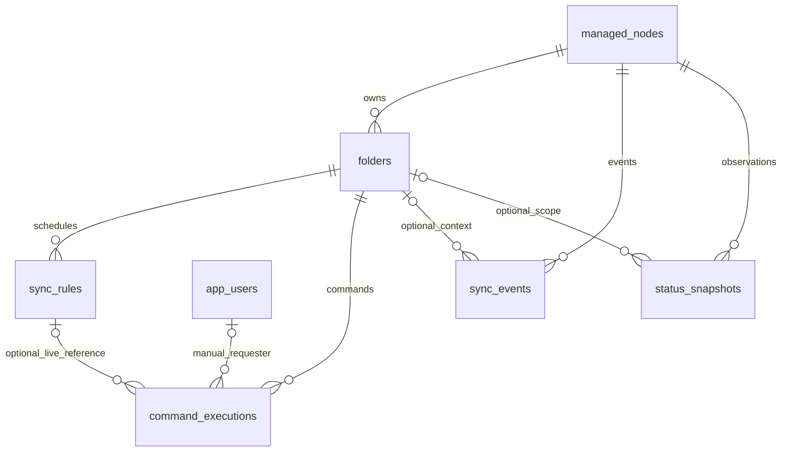

# Модель данных A0.1 — 0.1.0-draft

Реализована в A0.3: `app.models` и миграция `a003_initial_schema`. Семантика — в
[контракте](../../contracts.md) и [D-01–D-05](mvp-decisions.md).
Семь таблиц остаются достаточными; серверные подключения/секреты находятся в конфигурации.

## Общие правила

Все PK — UUID, созданные приложением. История — `timestamptz` (UTC на выводе).
Счётчики — `bigint>=0`; версии — `integer>=1`. Перечисления — text + CHECK,
чтобы миграции не зависели от изменения PostgreSQL enum-типа.
Все поля NOT NULL, кроме явно отмеченных `?`. created_at/updated_at ставит сервер;
updated_at обновляется триггером для app_users/managed_nodes/folders/sync_rules,
включая raw SQL. UUID создаёт приложение через uuid4, серверного UUID-default нет.
Объекты узлов и папок не удаляются через MVP API; выключение/отсутствие сохраняет историю.

## app_users

| Поле | Тип/ограничение |
|---|---|
| id | UUID PK |
| login | varchar(64), unique; нормализованная ASCII запись `[a-z0-9_.-]{1,64}` |
| password_hash | text; только поддерживаемый хеш, никогда не DTO |
| is_active | boolean, default true |
| created_at, updated_at | timestamptz |
| last_login_at? | timestamptz |

Пользователь создаётся административным bootstrap A2, публичного CRUD нет.
Подписанная cookie не требует таблицы сессий; активность проверяется в БД.
Удаление пользователя с историей команд — RESTRICT, деактивация доступна административно.

## managed_nodes

| Поле | Тип/ограничение |
|---|---|
| id | UUID PK |
| display_name | varchar(80), не пустая после trim |
| connection_ref | varchar(64), unique, ключ серверной настройки |
| enabled | boolean, default true |
| syncthing_device_id? | text; ожидаемый внешний ID после успешной регистрации |
| api_status | text, enum ApiStatus из OpenAPI, default unknown |
| last_checked_at?, last_seen_at? | timestamptz; последняя любая / успешная проверка |
| source_start_time_raw? | text; точный startTime без усечения точности |
| source_session_id? | char(64), lowercase hex |
| source_stream_anchor? | jsonb: id, точный time_raw, fingerprint; null для legacy/неподтверждённого источника |
| last_event_id | bigint, default 0 |
| created_at, updated_at | timestamptz |

CHECK: raw/session оба null либо оба заполнены; при пустой сессии курсор равен 0.
last_seen_at <= last_checked_at, если оба заполнены. last_seen_at не обновляется
при ошибке API. Ожидаемый Device ID не заменяется молча при identity_mismatch.
Коллектор меняет session/cursor/anchor атомарно с пакетом sync_events и маркером
границы под блокировкой узла. Непустой anchor требует сессию и ровно три поля
с ограничениями типов/формата; id находится в диапазоне 1..2^63-1, как в DTO
(ck_managed_nodes_stream_anchor). Legacy-сессия
без anchor сохраняется, но не доказывает непрерывность нового чтения.
Несколько папок одного экземпляра не создают несколько managed_nodes.

Миграция a101_stream_anchor после неизменённой a003_initial_schema добавляет
nullable JSONB и разрешает SourceContinuityLost. Старые курсоры и история
сохраняются. Downgrade отказывается удалять уже записанные ориентиры или
переименовывать неопределённую границу в рестарт. Порядок перехода —
[D-01, редакция 2](d01-stream-continuity.md).

## folders

| Поле | Тип/ограничение |
|---|---|
| id | UUID PK |
| node_id | UUID FK managed_nodes, ON DELETE RESTRICT |
| syncthing_folder_id | varchar(255), локальный внешний ID |
| label | varchar(80), отображаемая подпись, не физический путь |
| present | boolean; false при исчезновении из успешно прочитанной конфигурации |
| actual_paused? | boolean, последнее прочитанное поле конфигурации |
| config_observed_at? | timestamptz |
| runtime_state?, runtime_observed_at? | text / timestamptz |
| need_bytes?, pull_errors? | bigint>=0 |
| created_at, updated_at | timestamptz |

UNIQUE(node_id,syncthing_folder_id); UNIQUE(id,node_id) для составных ссылок истории.
config_observed_at и actual_paused оба null либо оба заполнены.
runtime_state/runtime_observed_at аналогично. Ошибка опроса не стирает старые поля.
desired_paused, active_rule_id и is_stale вычисляются для DTO, не являются колонками.
Исчезнувшая папка сохраняет UUID, правила и историю; команды ей не отправляются.

## sync_rules

| Поле | Тип/ограничение |
|---|---|
| id | UUID PK |
| folder_id | UUID FK folders, ON DELETE RESTRICT |
| timezone | varchar(64), IANA; проверяется приложением |
| days_mask | smallint, 1..127; бит 0 — понедельник, бит 6 — воскресенье |
| start_time, end_time | time without time zone; секунды/доли равны 0 |
| enabled | boolean, default true |
| version | integer>=1, default 1 |
| created_at, updated_at | timestamptz |

CHECK(start_time <> end_time). Partial UNIQUE(folder_id) WHERE enabled IS TRUE.
БД также отвергает секунды/доли и PostgreSQL-значение `24:00`, отсутствующее в HH:MM.
Days DTO — массив уникальных ISO-дней; преобразование: сумма `1 << (day-1)`.
Маска исключает неоднозначный порядок и дубликаты в БД. Пустой набор запрещён.
IANA timezone проверяется приложением по zoneinfo, не нестабильным SQL CHECK.
PATCH/DELETE используют expected_version и общую advisory-блокировку папки;
version не сбрасывается. Правило со всеми pending-командами изменяется под тем же ключом.

## command_executions

| Поле | Тип/ограничение |
|---|---|
| id | UUID PK |
| node_id, folder_id | составной FK (folder_id,node_id) -> folders(id,node_id), RESTRICT |
| source | text: rule / manual |
| rule_id? | UUID FK sync_rules, ON DELETE SET NULL |
| rule_version? | integer>=1, версия исходного правила |
| rule_snapshot? | jsonb: RuleSnapshot, содержит исходный rule_id и все параметры |
| requested_by? | UUID FK app_users, RESTRICT; обязателен для manual |
| idempotency_key? | UUID; обязателен для manual |
| desired_paused | boolean; для manual только false |
| status | text, enum ExecutionStatus, default pending |
| observed_paused?, restart_required? | boolean |
| source_session_id? | char(64), lowercase hex |
| created_at | timestamptz, время принятия намерения |
| sent_at?, verified_at?, completed_at? | timestamptz |
| error_code? | varchar(80), безопасный enum причины из контракта/реализации |

CHECK/индексы:

- source=rule: snapshot/version заполнены, requested_by/idempotency_key пусты.
  rule_id может стать null после удаления; snapshot остаётся неизменяемым.
- source=manual: rule_id/version/snapshot пусты, requested_by/key заполнены,
  desired_paused=false. UNIQUE(requested_by,idempotency_key) WHERE source='manual'.
- pending: completed_at и error_code пусты; verified_at пусто.
  Терминальные статусы имеют completed_at. cancelled имеет sent_at=NULL.
  applied имеет sent_at/verified_at, совпадающий observed_paused,
  restart_required=false, непустую source_session_id и пустой error_code.
  failed/unknown/cancelled требуют error_code.
- created_at <= sent_at <= completed_at для заполненных полей;
  created_at <= verified_at <= completed_at; verified_at не раньше sent_at.
- Partial UNIQUE(folder_id) WHERE status='pending': одна незавершённая попытка папки.
- Индексы (node_id,completed_at), (folder_id,created_at), (rule_id,created_at).

Связь snapshot/version/актуальной записи проверяет сервис. После удаления правила
сохраняется исходный ID в snapshot. Ошибка/отмена не увеличивают confirmed-команды.
Повтор создаёт новый UUID; терминальная строка не переводится обратно в pending.

## sync_events

| Поле | Тип/ограничение |
|---|---|
| id | UUID PK |
| node_id | UUID FK managed_nodes, RESTRICT |
| folder_id? | вместе с node_id составной FK -> folders(id,node_id), RESTRICT |
| kind | text: source / gap / restart |
| source_session_id | char(64), lowercase hex |
| source_event_id? | bigint>=1, только kind=source |
| event_type | varchar(80); внешний тип или HistoryGap/SourceRestarted/SourceContinuityLost |
| occurred_at? | timestamptz; для source обязателен |
| received_at | timestamptz |
| payload_summary | jsonb; только разрешённые поля Event.payload_summary |

UNIQUE(node_id,source_session_id,source_event_id) WHERE kind='source'.
CHECK: source_event_id заполнен только для source; kind=source требует occurred_at.
Локальные gap/restart имеют source_event_id=NULL и не занимают номера источника.
SourceContinuityLost имеет kind=restart, но не утверждает доказанный рестарт.
Неизвестная папка события допускает folder_id=NULL; произвольные пути не сохраняются.
JSONB CHECK требует object и только ключи from_id/to_id/state/previous_session_id;
проверка значений и фильтрация содержимого выполняются DTO/коллектором.
Индекс (node_id,received_at), (folder_id,received_at).
Маркер gap содержит включительные from_id/to_id; from_id<=to_id проверяется сервисом.

## status_snapshots

| Поле | Тип/ограничение |
|---|---|
| id | UUID PK |
| node_id | UUID FK managed_nodes, RESTRICT |
| folder_id? | вместе с node_id составной FK -> folders(id,node_id), RESTRICT |
| scope | text: node / folder |
| observed_at | timestamptz, время получения результата проверки |
| success | boolean, успешна ли именно эта проверка |
| error_code? | varchar(80) |
| actual_paused?, runtime_state? | boolean / text |
| need_bytes?, pull_errors? | bigint>=0 |

CHECK: scope=node требует folder_id=NULL и пустые folder-поля;
scope=folder требует folder_id. success=true требует error_code=NULL,
success=false — непустой error_code и пустые измеренные folder-поля.
Для folder-наблюдения success=true достаточно валидного чтения конфигурации;
runtime-поля могут отсутствовать (например, paused). Ошибка отдельного runtime
показывается собственным неуспешным folder-наблюдением и не обнуляет node success.
Коллектор создаёт ровно одно node-наблюдение за один завершённый node-probe.
Индексы (node_id,scope,observed_at), (folder_id,observed_at).
Аналитика доступности фильтрует строго scope=node.

## Проверки A0.3

Сценарии ниже проверены на отдельной PostgreSQL 18.6; воспроизведение —
[a03-runbook.md](a03-runbook.md). Коллектор/исполнитель ещё не реализованы:
атомарность проверяется прямой транзакцией, переходы состояний остаются сервису.

1. Применить/откатить/повторно применить миграцию на отдельной PostgreSQL.
2. Две конкурентные вставки enabled-правила: остаётся одно.
3. Повтор source-события отвергается, тот же номер в новой сессии принимается.
4. Ошибка транзакции пакета не продвигает курсор managed_nodes.
5. Удаление rule не удаляет command_executions и сохраняет snapshot.
6. Command/snapshot/event не связывается с папкой другого node_id.
7. Node/folder-наблюдения и неизвестные значения не смешиваются.
8. Недопустимые состояния команд и дубли manual-ключа блокируются ограничениями.

Часть семантики обеспечивается сервисом; перечисление CHECK не является
обещанием проверить межтабличные условия одним SQL-выражением.
Частичный unique — [механизм PostgreSQL](https://www.postgresql.org/docs/current/indexes-partial.html).
